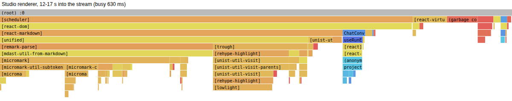
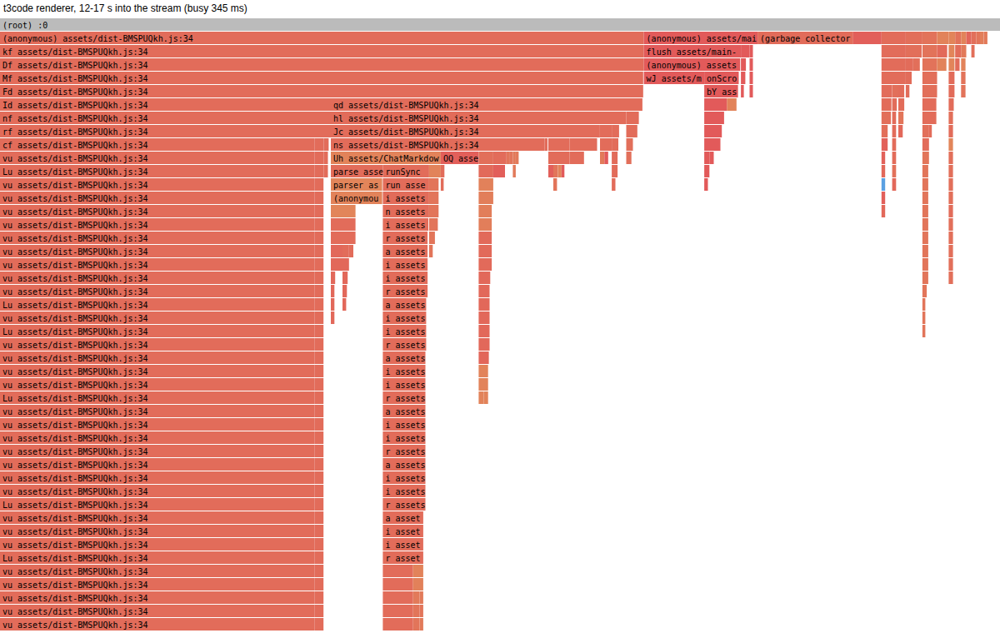

# Snappiness: Studio against t3code, 2026-10-25

Phase 1 of making Studio feel as fast as t3code: measure first, explain the
numbers, rank the fixes. No app code changed. The benchmark is
`scripts/bench-snappy/` (see `scripts/README.md`).

## Short version

On the same machine, Studio is already faster than t3code at most things a
user feels: it starts in about half the time (0.8 s against 1.7 s to a usable
window), uses about 45% less memory (420 MB against 770 MB), and draws a
typed character in the composer in about half the time (15 ms against 26 ms).

It is clearly slower in three places, ranked by how much a user would feel
them, and has two noisy spots worth a closer look:

1. **Streaming a long reply.** Studio's renderer spends about 3x as much
   JavaScript time as t3code's while a reply streams (894 ms against 282 ms in
   every 5 s, 30 s into a 40 s reply), and the cost grows with the reply:
   renderer CPU climbs from 24% in the first 10 s to 46% in the last. The
   profile says why: every update re-parses and re-highlights the whole
   message with react-markdown (about 70% of the busy time: parsing about 40%,
   highlight.js about 25%).
2. **Opening a long chat.** 322 ms against 217 ms for a 120-message chat.
   Only about 140 ms of it is renderer work (markdown about 60 ms); the rest
   is waiting, most likely for the run's data over IPC.
3. **The terminal.** Echo 29 ms against 23 ms; printing 200,000 lines takes
   165 ms against 115 ms (both noisy, but the same direction every round).

Noisy, not clear gaps: the first workspace switch after launch (median
92 ms like t3code's 90 ms, but p95 147 ms), and typing while five agents run
(median 19 ms like t3code's 18 ms, but p95 32 ms against 19 ms).

One more cost is not in these numbers: on a Wayland desktop (Etienne's COSMIC
session) Studio turns hardware acceleration off on purpose
(`src/main/index.ts`, a crash workaround), so every pixel is drawn on the
CPU. The benchmark runs on Xvfb, where neither app has a GPU, so this gap
cannot show up here. It may be the largest difference on the real machine.

## How it was measured

- Both apps built for production and run on a private Xvfb display
  (1920x1080, never a visible window), window 1440x900, through Playwright's
  Electron driver. Studio from this branch (`npx electron-vite build
  --sourcemap`), t3code at `909e4c94` (2026-10-24) built with its own
  `build:desktop`.
- t3code ran only inside a bubblewrap sandbox that sees one folder: no home,
  no /tmp, no D-Bus or keyring, no sign-ins, telemetry off. Its agent was a
  fake `pi` (shapes taken from t3code's own recorded Pi transcript) that
  streams the benchmark's text. Studio's stream is replayed from its main
  process in the same 4-character deltas at the same rate (150 a second,
  6,015 deltas, about 40 s), on event-log's 50 ms flush cadence.
- Same content in both: 40 workspaces (t3code: 40 projects, each with a
  thread, since its sidebar lists threads), a 120-message chat of about
  190 KB of markdown with code and tables, a folder of 3,000 files, a 2 MB
  TypeScript file.
- Five rounds; each round runs both apps back to back and swaps which goes
  first. Load average and free memory are recorded before every run; runs
  above a load of 12 (on 24 cores) or under 4 GB free would be dropped.
- "Key to pixels" is measured outside the page: a CDP screencast watches the
  composer or terminal region and records when the frame that shows the
  typed character reaches the screen. "Key to frame" is the in-page time
  from keydown to the next animation frame.
- CPU is read from /proc for every process in the app's tree, per process
  kind. Memory is PSS (shared pages split fairly). Main-thread time is split
  into script, style, layout and paint from a Chromium trace; hot functions
  come from a CPU profile, mapped back to source through source maps.

### What does not map one to one

- **Tab switch:** t3code has no chat and terminal tabs side by side; Studio
  only.
- **Browser pane:** Studio opens a new tab each time, t3code navigates its
  one browser panel. Studio's numbers for this flow were lost to a harness
  bug in the main run (fixed since); see the end for the separate check.
- **Big file:** t3code previews only the first 1 MB of the 2 MB file;
  Studio opens all of it in CodeMirror.
- **Agents:** Studio's agents are terminal programs (a TUI redrawing ten
  times a second); t3code's are chat threads. Each app ran five of its own
  kind (t3code: five threads streaming at once). The CPU numbers answer "what
  do five working agents cost", not "the same work".
- **t3code's main process includes its server** (it runs in a child of the
  Electron main process), which explains most of its larger main-process
  memory.
- **GPU process:** with no GPU, both apps composite in software. t3code's
  translucent, blurred surfaces are expensive to composite in software (40%
  of a core while streaming against Studio's 5%). On a real GPU that cost
  mostly disappears, so compare the renderer numbers, not the totals, when
  judging chat streaming. Forcing `--disable-gpu` on t3code gave the same
  numbers, so this is not a sandbox artifact.

### Noise

The ± figure is the spread of the per-round medians as a share of the
median. t3code's numbers are tight (mostly under 15%). Studio's start,
memory, switches and chat numbers are tight too; its typing, terminal and
stream numbers vary 20 to 50% between rounds. The machine had other agents
running (load 1.8 to 7.5 before each run, 8.7 to 12.2 GB free; no run was dropped), so treat
differences under about 20% as noise. The gaps called out above are all
well beyond that.

## Results

Lower is better except where noted. Medians and p95 over all samples from
accepted rounds; "Studio / t3code" under 1 means Studio is faster or lighter.

| Area | Measurement | Studio median | Studio p95 | t3code median | t3code p95 | Studio / t3code |
|---|---|---:|---:|---:|---:|---:|
| Start | First launch to usable (ms) | 862.3 ±5% | 884 | 1788.1 ±14% | 1958.8 | 0.48 |
| Start | Warm launch to first window (ms) | 298 ±6% | 308.6 | 1094 ±7% | 1110.4 | 0.27 |
| Start | Warm launch to usable (ms) | 788.1 ±5% | 810.1 | 1682.8 ±4% | 1716.1 | 0.47 |
| Idle | Idle CPU, all processes (%) | 1.6 ±38% | 1.8 | 1.7 ±35% | 2.1 | 0.94 |
| Idle | Memory, all processes (MB PSS) | 422.7 ±2% | 425.6 | 766.7 ±1% | 768 | 0.55 |
| Idle | Memory, renderer (MB PSS) | 128.3 ±1% | 128.9 | 240.4 ±0% | 240.7 | 0.53 |
| Idle | Memory, main incl. server (MB PSS) | 151.3 ±5% | 155 | 406.9 ±2% | 408.2 | 0.37 |
| Idle | Process count | 8 ±0% | 8 | 9 ±0% | 9 | 0.89 |
| Switch | Workspace/thread switch, click to painted (ms) | 33 ±9% | 69.7 | 46.3 ±21% | 87.8 | 0.71 |
| Switch | First switch after launch (ms) | 92.1 ±94% | 146.9 | 89.5 ±18% | 98.1 | 1.03 |
| Switch | Tab switch, chat to terminal (ms) | 8.4 ±85% | 15.8 | n/a  |  |  |
| Typing | Composer: key to frame, in page (ms) | 9.7 ±10% | 10.1 | 10 ±10% | 10.6 | 0.97 |
| Typing | Composer: key to frame p95, in page (ms) | 17.4 ±6% | 18.2 | 17.6 ±6% | 18 | 0.99 |
| Typing | Composer: key to pixels on screen (ms) | 14.8 ±32% | 16.5 | 26.1 ±21% | 29.7 | 0.57 |
| Typing | Composer: key to pixels p95 (ms) | 21.7 ±38% | 23.7 | 34.2 ±17% | 37.7 | 0.63 |
| Typing | Terminal: key to echo on screen (ms) | 29 ±29% | 35.2 | 23.2 ±42% | 30.6 | 1.25 |
| Typing | Terminal: key to echo p95 (ms) | 39.5 ±20% | 41.3 | 33.5 ±41% | 37.3 | 1.18 |
| Chat | Open 120-message chat (ms) | 322 ±7% | 340.7 | 217.4 ±22% | 232.8 | 1.48 |
| Chat | DOM nodes with that chat open | 1710 ±0% | 1710 | 3009 ±0% | 3009 | 0.57 |
| Chat | Scroll it: dropped frames (%) | 0  | 0 | 0  | 0.6 |  |
| Chat | Scroll it: long tasks (ms total) | 0  | 0 | 0  | 0 |  |
| Stream | Last delta sent to painted (ms) | 63.1 ±106% | 78.7 | 140.6 ±48% | 170.3 | 0.45 |
| Stream | Renderer CPU, 0-10 s (%) | 24.1 ±17% | 26.5 | 30.5 ±6% | 30.7 | 0.79 |
| Stream | Renderer CPU, 30-40 s (%) | 46 ±24% | 52.6 | 38.3 ±6% | 39.8 | 1.2 |
| Stream | GPU process CPU, 30-40 s (%) | 4.8 ±44% | 6.2 | 39.2 ±7% | 40.9 | 0.12 |
| Stream | Main process CPU, 30-40 s (%) | 3.9 ±13% | 4 | 6.3 ±35% | 8.1 | 0.62 |
| Stream | All processes CPU, 30-40 s (%) | 57.2 ±22% | 64.5 | 87.2 ±6% | 89.9 | 0.66 |
| Stream | Renderer main thread: script per 5 s at 25-30 s (ms) | 894.3 ±17% | 917.9 | 281.9 ±13% | 294.3 | 3.17 |
| Stream | Renderer main thread: layout+style per 5 s (ms) | 193 ±18% | 207.3 | 317.1 ±12% | 327.9 | 0.61 |
| Stream | Renderer main thread: paint per 5 s (ms) | 289.6 ±23% | 323.5 | 266.4 ±11% | 270.2 | 1.09 |
| Stream | Dropped frames while streaming (%) | 0.1 ±200% | 0.2 | 1.1 ±45% | 1.4 | 0.09 |
| Stream | Long tasks while streaming (count) | 0  | 0 | 2 ±100% | 3 | 0 |
| Files | Expand folder of 3,000 files (ms) | 52.2 ±30% | 56.1 | 64.6 ±24% | 74 | 0.81 |
| Files | Collapse it (ms) | 14.2 ±13% | 14.4 | 13 ±22% | 13.9 | 1.09 |
| Files | Scroll it: dropped frames (%) | 0  | 0 | 0  | 0 |  |
| Files | Open 2 MB file (ms) | 92.1 ±32% | 110.1 | 148.5 ±3% | 152 | 0.62 |
| Files | Scroll it: long tasks (ms total) | 0  | 0 | 256 ±20% | 268.6 | 0 |
| Browser | Load a local page in the browser pane (ms) | n/a  |  | 42.6 ±38% | 63.7 |  |
| Browser | Memory after 3 page loads (MB PSS) | n/a  |  | 1344.8 ±7% | 1345.9 |  |
| Terminal | Print 200,000 lines (ms) | 165 ±52% | 203.4 | 115 ±32% | 125 | 1.43 |
| Terminal | CPU while printing, first 6 s (%) | 19.1 ±40% | 24.5 | 21.5 ±28% | 25.2 | 0.89 |
| Terminal | Scroll scrollback: dropped frames (%) | 0  | 0 | 0  | 0 |  |
| Agents | 5 agents, none on screen: CPU (%) | 16.8 ±15% | 18.7 | 24.1 ±48% | 31.5 | 0.7 |
| Agents | 5 agents, one on screen: CPU (%) | 22.2 ±22% | 25.3 | 100.6 ±6% | 103.5 | 0.22 |
| Agents | 5 agents, one on screen: renderer+GPU CPU (%) | 17.2 ±22% | 19.6 | 81.3 ±6% | 83.3 | 0.21 |
| Agents | 5 agents: memory (MB PSS) | 613.2 ±3% | 618.9 | 989.4 ±2% | 996.3 | 0.62 |
| Agents | Composer key to pixels with 5 agents (ms) | 19.2 ±73% | 32 | 18.2 ±6% | 18.8 | 1.05 |

## Why: the slow paths

### 1. Streaming a reply re-renders the whole message

Flame graph of 5 s of Studio's renderer, 12 to 17 s into the stream
(library frames collapsed into one box per package):



`Markdown` (`src/renderer/src/components/chat/Markdown.tsx`) passes the full
text to `react-markdown` on every flush. Each flush therefore re-runs
remark-parse over the whole reply, rebuilds the HAST tree, re-runs
rehype-highlight (highlight.js through lowlight) over every code block, and
lets React diff the whole result. The work per flush is proportional to the
length of the reply so far, which is why renderer CPU grows from 26% to 48%
over the stream. The plugin arrays are already hoisted; the remaining cost
is the parse itself. `projectRunExecution` (`useRunExecutionRecord.ts`)
also re-projects all events of the run per flush, but it is about 4% of the
profile.

t3code's renderer for the same stream (its own bundle has no source maps):



Nothing is dropped yet (0 long tasks, 0.1% dropped frames at this length),
but the cost keeps growing with longer replies, competes with typing in the
composer while a reply streams, and keeps a core busy on battery.

### 2. Opening a long chat

A CPU profile of one open (310 ms) shows the renderer's main thread busy for
only 141 ms of it: React commit about 50 ms, `react-markdown` 61 ms (parse
37 ms, highlight 16 ms) for the rows Virtuoso renders on first paint
(`initialItemCount={Math.min(rowCount, 24)}` in `ChatConversation.tsx`, a
guard against a blank chat in an occluded window), and 16 ms in
`TabBar.tsx` itself. The other ~170 ms the thread is idle, waiting: the
open fetches the run over IPC before it can render, so the next step is to
time that fetch and the run projection in main.

### 3. Typing while agents run (noisy)

The median is fine (19 ms), the p95 is not (32 ms). A profile of 40 keys
with five agents running shows the renderer's main thread only 3 to 5% busy
(the composer's own handler at `ChatComposer.tsx:547` costs about 1.3 ms a
key, xterm 22 ms in total). So when a key is late, the delay is outside the
renderer's main thread: the main process (which routes input and parses
every pty's output for agent detection) or the compositor. A trace of the
browser process is the next step.

### 4. First switch after launch (noisy)

Later switches take 33 ms; the first one is 92 ms at the median but up to
147 ms, which points at work done once (a lazy chunk, the first Explorer
mount, a cold cache) rather than at the switch itself.

### 5. Terminal

Studio's pty output goes through main (agent detection parses it) before the
renderer's xterm; t3code's ghostty terminal gets it more directly. The gap
is small (6 ms per key, 50 ms per 200,000 lines) and both numbers vary 30
to 50% between rounds.

## Fixes, ranked

| # | Fix | Expected gain | Risk | Size |
|---|---|---|---|---|
| 1 | Streamed markdown: split the message into top-level blocks, render each finished block once (memoized by its text) and re-parse only the last, growing block; skip highlighting a code fence until it is closed. | Renderer script while streaming from about 890 to under 250 ms per 5 s; renderer CPU flat at about 20 to 25% instead of growing to 46%. Also speeds up fix 2. | Low to medium: block splitting must respect fences, lists, tables and reference links. Covered by rendering the existing chat fixtures both ways and comparing the HTML. | S to M |
| 2 | Chat open: time the run fetch and projection in main (the renderer waits ~170 ms), then cache parsed markdown per message (comes with fix 1). | About 100 ms per open of a long chat (322 to about 220 ms). | Low to medium: keep the occluded-window guard working (its e2e exists). | S to M |
| 3 | Late keys with agents running: trace the main process; if pty parsing delays input, move agent detection off the main thread or coalesce it. | p95 key to pixels with agents from 32 to about 20 ms. | Medium. | M |
| 4 | First workspace switch: find the one-time work and do it while idle after start. | Up to about 60 ms, first switch only. | Low. | S |
| 5 | Wayland hardware acceleration: measure on the real COSMIC desktop with `CODARA_WAYLAND_HARDWARE_ACCELERATION=1` (the flag exists) before deciding anything. | Unknown; potentially the largest felt difference on Etienne's machine. | High if turned on for everyone: it was turned off because of crashes. Needs Etienne's decision. | S to test |
| 6 | Terminal path: measure where the 50 ms per 200,000 lines goes (main-side parsing against renderer). | Small. | Medium. | M |

Fixes 1 and 2 share most of their code and would come first. Each fix lands
as its own PR against Cora with before/after numbers from this benchmark.

## Where Studio is already ahead

Start (0.8 s against 1.7 s), memory (420 MB against 770 MB idle, 610 MB
against 990 MB with five agents), composer echo (15 ms against 26 ms),
opening a 2 MB file (92 ms against 149 ms, and the whole file), the cost of
an agent on screen (22% against 100% CPU in this setup), workspace switches
(33 ms against 46 ms), and no long tasks while streaming or scrolling. These are worth protecting: run the benchmark
before and after each fix.

## Still open

- A main-process trace for the chat open (the IPC wait) and for late keys
  with agents running, before writing fixes 2 and 3.
- Studio's browser-pane numbers (a harness bug in the main run, fixed in
  this branch).
- The Wayland measurement, which needs the real desktop.

## Reproduce

```sh
npx electron-vite build --sourcemap
export T3CODE_BENCH_DIR=/path/to/empty/folder
scripts/bench-snappy/t3code/setup.sh
node scripts/bench-snappy/run.mjs --apps t3code --build-profile
node scripts/bench-snappy/run.mjs --apps studio,t3code --rounds 5 --out /tmp/ab
node scripts/bench-snappy/summarize.mjs /tmp/ab
node scripts/bench-snappy/flames.mjs /tmp/ab
```
